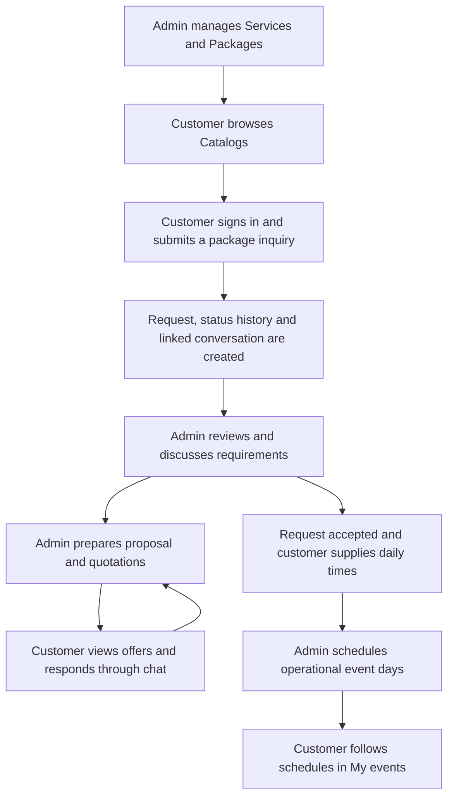

# Admin to Customer Process Flow

AMAC supports this overall journey:

**Admin prepares packages and services → customer browses and submits an inquiry → admin reviews and discusses requirements → admin prepares quotations and schedules event days → customer follows everything through My events and Messages.**

An accepted request, a sent quotation, and an operational schedule are separate records. **None currently confirms a booking or reserves a date.**

This document's original process investigation inspected source on 2026-11-15, on `main` at `311c4cf`, including the local files present during the investigation. The quotation section below reflects the Send and Cancel flow. See the [product reference](../context-factory/business/product.md) for scope and current implementation. This is a process explanation, not a new business-policy decision.

## Overall flow

Quotation preparation and scheduling are separate workflows. A sent quotation is not a prerequisite enforced by the scheduling process. Customers can supply daily times before the admin accepts the request; acceptance is required when the admin creates operational schedules.

## 1. Accounts and access

There are two account roles:

| Role                 | Main responsibility                                                                         |
| -------------------- | ------------------------------------------------------------------------------------------- |
| System Administrator | Manage catalogs, review requests, communicate, prepare quotations, and manage schedules     |
| Customer             | Browse catalogs, submit inquiries, provide details, view their own records, and communicate |

The process is:

1. A person registers or signs in using email/password, or an optional configured Firebase method.
2. Registration creates a customer account.
3. The server retrieves the saved account and role.
4. Admins enter the admin workspace; customers enter the customer workspace.
5. The API checks permissions again when someone requests data or performs an action.

Customers cannot promote themselves to admin or access another customer's inquiries, conversations, or quotations. Account settings can connect another sign-in method to the same account; this does not grant additional permissions. Matching email addresses do not automatically merge separate accounts.

When a session expires, the application returns the person to login and preserves an eligible workspace destination.

Source: [server authentication middleware](../apps/api/src/middleware/auth.ts), [customer registration data](../apps/api/src/data/auth/create-local-user.ts), and [workspace routes](../apps/web/src/components/app/routes.ts).

## 2. Admin Services to Customer Services

The Services module manages the individual services customers can browse and admins can reference while preparing packages and quotations.

The admin process is:

1. Open **Services**.
2. Create a listing with its information, photo, rate information where applicable, and presentation content.
3. Save it.
4. The saved listing becomes available in the customer catalog.
5. Edit the listing when its information changes.
6. Archive it when it should disappear from active browsing.
7. Delete an archived record when its references permit deletion.

The customer can browse service listings and discuss a service with the admin.

Service browsing and links help the customer discuss options with the admin. The admin adds requested extras to the private package so they appear in each new quotation.

Source: [admin Services screen](../apps/web/src/components/workspaces/admin/catalog/ServicesPage.tsx) and [service operations](../apps/api/src/services/services/).

## 3. Admin Packages to Customer Packages

Packages bring together the customer-facing offer: name, price, maximum guests, description, visual content, and linked services.

The admin process is:

1. Open **Packages**.
2. Create a package and prepare its content.
3. Set its PHP package price and maximum guest capacity.
4. Associate relevant services.
5. Save the package.
6. Customers can find it in the catalog and open its detail page.
7. Later changes are saved directly; archiving removes the package from active browsing and new inquiry selection.

A catalog save publishes the record immediately. There is no separate editorial approval step between saving and publication.

The server checks duplicate titles, service references, and whether another admin has changed the package since it was loaded. An archived package cannot be edited through the normal update operation. A package referenced by a booking request cannot be deleted.

Existing inquiries read the package name, price, and guest capacity from their referenced catalog package, so later catalog edits appear on those inquiries. Saved quotation amounts remain unchanged.

Source: [package creation](../apps/api/src/services/packages/create-package.ts), [package updates](../apps/api/src/services/packages/update-package.ts), and [package deletion](../apps/api/src/services/packages/delete-package.ts).

## 4. Customer Home and Catalogs

Customer **Home** retains the welcome, **Explore catalogs**, and **My events**. **Your next step** gives the customer one action based on their own activity. The card can open a request’s conversation when the team needs details, show a current sent quotation, resume an unfinished chat draft, or open an active request in My events. Customers with only closed requests can view their history. Customers just getting started can open the Messages composer with **Start planning**. A date on the card is labeled as requested.

Inside **Catalogs**, customers switch between Packages and Services. They can filter packages by total price and required guest capacity, and services by hourly-rate ranges.

The customer journey is:

1. Browse public pages or the signed-in catalog.
2. Open a package to inspect its content.
3. Choose **Book now**.
4. Sign in when required.
5. Continue to the package inquiry form.

The public package action passes the chosen package into the login/workspace journey. Where a visitor has already filled a signed-out request draft, the current tab retains it through sign-in and presents it for explicit review.

Source: [customer workspace](../apps/web/src/components/workspaces/customer/CustomerDashboard.tsx), [Home action selection](../apps/web/src/lib/services/customer-home/next-step.ts), [customer catalog](../apps/web/src/components/workspaces/customer/catalog/CustomerCatalogPage.tsx), and [request draft storage](../apps/web/src/lib/services/booking-requests/booking-draft.ts).

## 5. Customer booking request submission

The current request form collects:

- Event type: Birthday, Wedding, Corporate, or a custom type.
- One date or multiple dates.
- Contact person.
- Phone number.
- Optional special requests.

The browser also supplies the booking timezone.

For a multi-day inquiry, customers must choose at least two distinct dates. Dates can be nonconsecutive and are saved chronologically. Past dates are rejected according to the booking timezone.

On submission, the server:

1. Checks the customer's session and role.
2. Checks that the package is still available.
3. Rejects a stale package revision rather than silently using changed information.
4. Saves the request with a generated reference.
5. Records the selected package's name, price, and maximum guests.
6. Saves the requested dates, initially without start/end times.
7. Sets the status to `under_review`.
8. Creates the initial status-history entry.
9. Automatically creates a conversation linked to that request.

These records are created together in a transaction. The customer receives the request reference. A successful submission clears the saved draft; cancelling the draft also clears it.

Two implementation details matter:

- **Guest count:** the API supports it, but the current form does not submit it.
- **Physical event location:** business guidance describes discussing it, but the current creation form/API input does not collect a structured location; new requests save that field as empty.

The customer can communicate those details through notes and chat, but that does not automatically populate a structured location field.

Source: [request form](../apps/web/src/components/booking-requests/BookingRequestDialog.tsx), [request schemas](../apps/api/src/controllers/booking-requests/schemas.ts), and [request creation](../apps/api/src/services/booking-requests/create-booking-request.ts).

## 6. Admin Bookings and request review

The admin opens **Bookings**, filters requests, selects a request, and enters its detail workspace.

The booking workspace contains **Details**, **Package**, and **Quotation** tabs. Event-day scheduling is available within the booking details.

The review process is:

1. Read the customer's event information and requested dates.
2. Check the originally selected package.
3. Discuss missing details or changes in the linked conversation.
4. Update the request status.
5. Continue proposal, quotation, and scheduling work as appropriate.

The available statuses are:

| Status          | Meaning and effect                                                    |
| --------------- | --------------------------------------------------------------------- |
| `under_review`  | Initial submitted inquiry                                             |
| `needs_details` | Admin needs more information; a reason is required                    |
| `accepted`      | Accepted for processing; operational scheduling becomes eligible      |
| `declined`      | Closed request; a reason is required                                  |
| `cancelled`     | Closed request; a reason is required and scheduled days are cancelled |

Every status change records its actor, time, and reason where supplied.

The current admin transitions are:

| Current status            | Available different target statuses                  |
| ------------------------- | ---------------------------------------------------- |
| `under_review`            | `needs_details`, `accepted`, `declined`, `cancelled` |
| `needs_details`           | `accepted`, `declined`, `cancelled`                  |
| `accepted`                | `needs_details`, `declined`, `cancelled`             |
| `declined` or `cancelled` | None                                                 |

Requests cannot return to `under_review`. Declined and cancelled requests cannot be reopened through the current status operation.

Cancellation automatically cancels scheduled event days; changing a request to declined does not run that cancellation process.

There is no implemented request status for **confirmed** or **completed**. Missing details are discussed through chat; changing to `needs_details` does not create a new general-purpose customer editing form.

Source: [admin booking workspace](../apps/web/src/components/workspaces/admin/booking-requests/BookingRequestPage.tsx), [status-change service](../apps/api/src/services/booking-requests/update-booking-status.ts), and [status validation](../apps/api/src/controllers/booking-requests/schemas.ts).

## 7. Messages and ongoing coordination

Every submitted booking request has its own conversation. The customer does not need to create another chat for that inquiry.

The flow is:

1. The customer submits a request.
2. Its conversation appears in both workspaces.
3. The admin asks questions or explains the proposed arrangements.
4. The customer supplies information, raises concerns, or requests changes.
5. The admin continues work on the request, proposal, or quotation.

The conversation provides separate controls:

| Control         | Opens                                                                           |
| --------------- | ------------------------------------------------------------------------------- |
| Details         | Event, contact, requested-date information, and a link to the request workspace |
| Current package | The current proposal, including a private custom package when present           |
| Quotation       | The latest quotation version that was actually sent                             |

A quotation message opens the exact version linked to that message, so an older offer remains inspectable after a revision. The header's Quotation control shows the most recently delivered offer while the admin prepares a replacement.

Messages retain history and unread/read state. Opening a thread marks the other side's messages as read. Both workspaces refresh every five seconds. Earlier conversations and messages load as the user scrolls.

Customers can also start a general conversation without a booking request. That chat does not create an inquiry or reserve anything.

Signed-in conversations do not automatically expire and have no stored closed state. Previously closed booking-linked conversations support messaging and quotation delivery. Guest expiry is derived from the latest saved message, falling back to creation time, plus 24 hours.

Source: [conversation context](../apps/web/src/components/messages/ConversationContext.tsx), [customer message sending](../apps/api/src/services/messages/send-customer-message.ts), and [admin message sending](../apps/api/src/services/messages/send-admin-message.ts).

## 8. Booking Package and private proposals

When the standard package needs changes, the admin uses the booking's **Package** tab.

The process is:

1. Load the current proposal.
2. Choose **Edit package**.
3. Start from the original package or another catalog base.
4. Change the content, price, capacity, or linked services.
5. Save the proposal.
6. The first save creates a private package owned by that booking, with independently copied source uploads.
7. Later saves update that private package.

This private package does not appear in public catalogs or become selectable for another customer's new inquiry. The customer who owns the booking can view its current contents, including before a quotation is sent.

Three records remain distinct:

| Record                     | Purpose                                                                                                   |
| -------------------------- | --------------------------------------------------------------------------------------------------------- |
| Inquiry package reference  | Reads the current name, price, and capacity from the originally selected catalog package                           |
| Current proposal           | Shows the latest package being discussed; uses the original catalog record until a private package exists |
| Quotation versions         | Preserve offered prices and adjustments                                                                   |

Private package changes are audited, including who changed them. Declined and cancelled requests cannot be customized. Stale booking or package revisions are rejected.

Source: [booking package screen](../apps/web/src/components/booking-requests/BookingPackage.tsx), [private package saving](../apps/api/src/services/booking-requests/save-custom-package.ts), and [current package resolution](../apps/api/src/data/booking-requests/resolve-booking-package.ts).

## 9. Quotations and revisions

Only System Administrators prepare and send quotations.

1. Open the booking's **Quotation** tab and prepare an offer. The editor shows the current package base price and the booking's offered add-ons.
2. Set add-on hours on the booking, and add any manual fee or discount to the quotation.
3. Add or change service offers on the booking request. Saved offers supply the quotation pricing.
4. Choose **Cancel** to discard the unsent quotation, or **Send** to record the exact offer and add its message to the linked conversation. A saved booking offer persists after cancellation.
5. The customer opens an offer through the booking details or the exact-version message and responds through chat.

A package-only quotation is valid. The server requires an open request, current proposal, complete add-on pricing and hours, a nonnegative total, and a linked conversation. Quote and message creation succeed together.

For a revision, the admin supplies a reason and reviews the current package and add-ons. Cancelling or failing to send leaves the previous offer active. When the replacement sends, the previous offer becomes superseded and remains in history with its original amounts and message.

Source: [quotation editor](../apps/web/src/components/quotations/Quotations.tsx), [quotation delivery](../apps/api/src/services/quotations/send-quotation.ts), and [quotation history](../apps/api/src/data/quotations/list-quotations.ts).

## 10. Event days and operational scheduling

For new requests, the customer supplies times and the admin creates the operational schedules:

1. The customer opens **My events**.
2. Opens the request details.
3. Saves a start and end time for each requested date.
4. The admin accepts the request for processing, if not already accepted.
5. The admin opens its **Event days** section.
6. The admin schedules the ready requested days.

Customer times can be edited while the request is under review, needs details, or is accepted, provided that day has no operational schedule yet. The selected dates stay fixed. An end time can fall on the following day for an overnight event. Both times are interpreted in the booking timezone.

When the admin schedules:

- Days with both times and no linked schedule are created and linked.
- Days still missing times remain waiting.
- Existing linked days are skipped.
- A changed request revision causes rejection and refresh, protecting against stale details.

For subsequent changes:

- **Move:** creates a replacement schedule and retains the original as moved. The request must still be accepted.
- **Cancel day:** retains the record as cancelled.
- **Cancel request:** cancels its currently scheduled days.

The customer response follows the replacement chain, so the current operational schedule appears alongside the original requested information. Moving an operational schedule does not rewrite the customer's original requested date and times.

Older requests without a requested-day list retain manual admin schedule creation. For new requests, scheduling proceeds through the requested-day workflow.

The standalone Calendar demo is separate from these real booking-specific scheduling controls. Operational scheduling does not establish an exclusive date hold or confirm the booking.

Source: [requested-day time saving](../apps/api/src/services/booking-requests/save-requested-day-times.ts), [requested-day scheduling](../apps/api/src/services/event-days/schedule-requested-days.ts), [legacy schedule creation](../apps/api/src/services/event-days/create-event-day.ts), [schedule movement](../apps/api/src/services/event-days/move-event-day.ts), [schedule cancellation](../apps/api/src/services/event-days/cancel-event-day.ts), and [customer schedule response](../apps/api/src/services/booking-requests/booking-request-response.ts).

## 11. Customer My events

My events displays the customer's own requests in groups:

- Today.
- Upcoming.
- Dates to arrange.
- Past dates.
- Closed requests.

These groups are based on requested dates and request status. **Past dates does not mean an event has been marked completed.**

From a request, the customer can:

1. Inspect event details and status history.
2. View the current proposal.
3. Read sent quotations.
4. Enter or update eligible requested-day times.
5. View operational schedule information.
6. Open its linked conversation.
7. Cancel an open request with a reason.

Cancellation is available for requests under review, needing details, or accepted for processing. It records history and cancels scheduled days. Declined and cancelled requests remain readable but cannot be cancelled again.

Source: [request list and details](../apps/web/src/components/booking-requests/BookingList.tsx) and [customer cancellation](../apps/api/src/services/booking-requests/cancel-booking-request.ts).

## 12. Admin Customers and shared Account settings

The **Customers** directory is backed by saved customer accounts. Admins can search by name/email, page through results, and inspect account information.

It currently provides customer totals and joined-this-month figures. It is read-only: it does not provide customer-profile editing or role promotion. Its active-inquiries statistic is explicitly marked **Coming soon**. Some detail fields are placeholders.

The admin shell displays a generic demo banner on this screen, but the customer list and its implemented population statistics come from the API.

**Account settings**, available from either account menu, shows the person's name, email address, and sign-in methods. Customers and administrators can change their own password, add a password after verifying their connected account, or connect a Google account.

Source: [Customers screen](../apps/web/src/components/workspaces/admin/users/CustomersPage.tsx), [shared account settings](../apps/web/src/components/auth/AccountSettings.tsx), and [sign-in methods](../apps/web/src/components/auth/SignInMethods.tsx).

## 13. Demo screens, removed modules, and unfinished workflows

The main admin sidebar contains **Overview**, **Bookings**, **Messages**, **Customers**, **Packages**, and **Services**. Additional routes remain recognized by the application, but their presence does not establish a working business process.

| Area                                              | Current boundary                                                                |
| ------------------------------------------------- | ------------------------------------------------------------------------------- |
| Overview                                          | Sample metrics, charts, and sample event rows; navigation works                 |
| Standalone Calendar                               | Static sample schedule and demo actions                                         |
| Operations                                        | Sample timeline, incidents, and resource information                            |
| Reports                                           | Sample figures/charts; export does not generate a report                        |
| Inventory                                         | Demo screen; inventory management is outside approved scope                     |
| Staff, venue catalog, event checklists            | Removed from the current implementation                                         |
| AI assistant and automated handoff                | Not implemented                                                                 |
| Requirements-first inquiries                      | No formal request intake without selecting a package; general chat is available |
| Booking confirmation and date holds               | Not implemented; rules remain unresolved                                        |
| Payments, balances, receipts, supplier management | Outside approved scope                                                          |
| Managed past-events showcase                      | Later work                                                                      |

Some demo labels mention confirmed bookings, completed events, or expiring quotations. They do not describe implemented state transitions.

The implemented journey currently covers inquiry review, communication, current proposals, quotation history, and operational scheduling. It does not provide the complete confirmation, event-completion, or reporting lifecycle.

Source: [admin sidebar navigation](../apps/web/src/components/workspaces/admin/navigation.ts), [workspace route mapping](../apps/web/src/components/app/routes.ts), [Overview](../apps/web/src/components/workspaces/admin/overview/OverviewPage.tsx), [Calendar](../apps/web/src/components/workspaces/admin/calendar/CalendarPage.tsx), [Operations](../apps/web/src/components/workspaces/admin/operations/OperationsPage.tsx), [Reports](../apps/web/src/components/workspaces/admin/reports/ReportsPage.tsx), and [approved product scope](../context-factory/business/product.md#product-scope).

## Evidence and verification limits

The underlying investigation used current source, business references, and existing test definitions. No live browser, API, database, or production checks were run for this process explanation. Sample prices in this document are illustrative, not approved offers.

The [business domain references](../context-factory/business/README.md) describe intended responsibilities. Where intended behavior differs from current implementation, the distinction is stated above. Historical documentation and demo screens do not establish implemented features.
